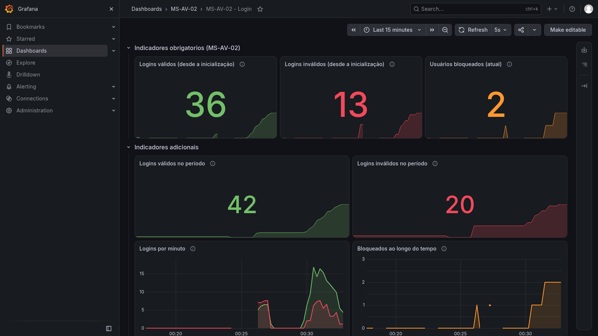

# ms-av-02-seguranca-observabilidade

- Microsserviço de *login* em **Spring Boot** que atende ao enunciado [MS-AV-02 - Segurança e Observabilidade](https://github.com/esensato/ms-2026-02/blob/main/MS-AV-02-Seguran%C3%A7a-Observabilidade.md) da disciplina ([repositório de referência](https://github.com/esensato/ms-2026-02))
- O conteúdo está dividido em três blocos, que aparecem também no histórico de *commits*:
    - **01 - Documentação de Endpoints** (*OpenAPI* / *Swagger*)
    - **02 - Métricas** (*Actuator*, *health check*, *Micrometer*, *Prometheus* e *Grafana*)
    - **03 - Segurança** (*Basic* + `JdbcUserDetailsManager` com *roles* e *BCrypt*; *OAuth2* com *Keycloak* como extensão opcional)
- A solução inteira roda em **Docker Compose**:

```bash
git clone https://github.com/LuizPazdziora/ms-av-02-seguranca-observabilidade.git
cd ms-av-02-seguranca-observabilidade
docker compose up --build -d
```

## Pré-requisitos

- **Docker** e **Docker Compose v2** (`docker compose version`)
- JDK local **não** é necessário: o *build* e os testes rodam dentro de contêineres
- Opcional, para o teste de aceitação: `bash`, `curl`, `git` e `openssl` (Linux, macOS, WSL ou Git Bash)

## Arquitetura

- `login-service`: o microsserviço Spring Boot, com o banco **H2 em modo arquivo** gravado no volume `h2-data`
- `prometheus`: coleta as métricas do `login-service` a cada 5 segundos
- `grafana`: exibe o *dashboard* `MS-AV-02 - Login`, com *datasource* e *dashboard* provisionados automaticamente
- `keycloak`: **extensão opcional** (*profile* `oauth2`), emite tokens JWT
- Os contêineres se comunicam **pelo nome do serviço** na rede interna do Compose (nunca `localhost` nem `host.docker.internal` entre contêineres)

```text
                      navegador / curl (somente 127.0.0.1)
          :8080 API+Swagger   :8081 Actuator   :9095 Prometheus   :3000 Grafana   :9090 Keycloak (opcional)
                 |                 |                  |                 |                  |
   +-------------v-----------------v--+   scrape      |                 |                  |
   |          login-service            |<-------------+ prometheus <-----+ grafana          |
   |  (Spring Boot + H2 em /data)      |  login-service:8081   ^  http://prometheus:9090    |
   +----------------+------------------+                       |                            |
                    | JWKs (profile oauth2): http://keycloak:8080/realms/seguranca/...      |
                    +---------------------------------------------------------------> keycloak
```

## Estrutura do Repositório

```text
ms-av-02-seguranca-observabilidade/
├── README.md
├── .gitignore / .gitattributes
├── .env.example                          # valores de demonstração (o .env real não é versionado)
├── docker-compose.yml                    # login-service + Prometheus + Grafana
├── docker-compose.oauth2.yml             # extensão opcional: Keycloak + profile oauth2
├── docker-compose.evidencias.yml         # opcional: renderizador de imagens do Grafana
├── img/dashboard-grafana.png             # captura real do dashboard
├── login-service/                        # projeto Spring Boot (Maven wrapper)
│   ├── Dockerfile / .dockerignore / pom.xml / mvnw / mvnw.cmd / .mvn/
│   └── src/
│       ├── main/java/aula/microservicos/login/
│       │   ├── LoginApplication.java
│       │   ├── controller/   LoginController, TokenController (opcional)
│       │   ├── bean/         LoginBean, TrocaSenhaBean, CadastroUsuarioBean, UsuarioBean
│       │   ├── entity/       UsuarioEntity, LoginAttemptEntity
│       │   ├── repository/   UsuarioRepository, LoginAttemptRepository
│       │   ├── servico/      LoginServico, CargaInicialUsuarios
│       │   ├── exception/    GlobalExceptionHandler e exceções de negócio
│       │   ├── metrica/      MetricaLogin, DatabaseHealthContributor
│       │   └── config/       SenhaConfig, UsuarioJdbcConfig, SecurityConfig, OpenApiBasicConfig,
│       │                     OAuth2SecurityConfig, OpenApiOAuth2Config, JwtConverter
│       ├── main/resources/   application.properties, application-oauth2.properties, schema.sql
│       └── test/             LoginControllerTests, SincronizacaoUsuarioTests, MetricaLoginTests,
│                             BeanValidacaoTests, OAuth2SecurityTests, application-test.properties
├── observabilidade/
│   ├── prometheus-config.yml
│   └── grafana/
│       ├── provisioning/datasources/prometheus.yml
│       ├── provisioning/dashboards/dashboards.yml
│       └── dashboards/dashboard-login.json   # exportado do Grafana
├── keycloak/
│   ├── realm-seguranca.json                  # sem senhas
│   └── configurar-usuarios.sh                # define as senhas a partir do .env
├── scripts/aceitacao.sh
└── requisicoes/ms-av-02.postman_collection.json
```

## Docker

- `login-service/Dockerfile` em duas etapas, no estilo da seção "Efetuando o Deploy" do material:
    - **build**: `eclipse-temurin:17.0.20.1_1-jdk`, baixa as dependências (`dependency:go-offline`) e executa `./mvnw clean package` **com os testes automatizados**
    - **execução**: `eclipse-temurin:17.0.20.1_1-jre`, com `curl` (para o *health check*), usuário sem privilégios `app` e o diretório `/data` (volume do H2) pertencente a ele

```dockerfile
# Etapa 1 - build e testes
FROM eclipse-temurin:17.0.20.1_1-jdk AS build
...
ARG SKIP_TESTS=false
RUN ./mvnw -B clean package -DskipTests=${SKIP_TESTS}

# Etapa 2 - execucao
FROM eclipse-temurin:17.0.20.1_1-jre
...
USER app
CMD ["java", "-jar", "app.jar"]
```

- `docker-compose.yml` na raiz:
    - **volumes nomeados**: `h2-data` (banco), `prometheus-data` e `grafana-data`
    - ***health checks***: `login-service` via `curl` no `/actuator/health` (porta 8081); `prometheus` e `grafana` via `wget` (as duas imagens têm `wget`, mas não `curl` - conferido com `docker compose exec <servico> sh -c "command -v wget curl"`)
    - `restart: unless-stopped` em todos os serviços
    - `depends_on`: o Prometheus depende do `login-service` só como `service_started` (ele tenta a coleta de novo sozinho; assim uma falha da aplicação não esconde o Prometheus durante o diagnóstico); o Grafana espera o Prometheus ficar `healthy`
- Imagens sempre com *tag* fixa (nunca `latest`):

| Imagem | Tag |
|---|---|
| `eclipse-temurin` (build / execução) | `17.0.20.1_1-jdk` / `17.0.20.1_1-jre` |
| `prom/prometheus` | `v3.15.0` |
| `grafana/grafana` | `13.2.4` |
| `quay.io/keycloak/keycloak` (opcional) | `26.8.0` |
| `grafana/grafana-image-renderer` (opcional) | `v5.12.6` |
| `zricethezav/gitleaks` (aceitação) | `v8.30.0` |

## Portas

- Todas as portas são publicadas **somente em `127.0.0.1`**: o *Actuator* mostra detalhes do banco e o Grafana tem login administrativo, e nada disso precisa ficar exposto na rede

| Porta | Serviço |
|---|---|
| 8080 | API e Swagger (`login-service`) |
| 8081 | *Actuator* (`login-service`) |
| 9095 | Prometheus (porta 9090 do contêiner) |
| 3000 | Grafana |
| 9090 | Keycloak (extensão opcional) |

- A porta 9090 do computador fica reservada para o Keycloak, como no material; por isso o Prometheus é publicado em 9095

## Inicialização e Encerramento

- Subir tudo (o *build* executa os testes automatizados):

```bash
docker compose up --build -d
```

- Conferir os serviços (todos devem ficar `healthy`) e os *logs*:

```bash
docker compose ps
docker compose logs --tail=200
docker compose logs -f login-service
```

- Subir sem executar os testes no *build* (somente para agilizar o desenvolvimento):

```bash
SKIP_TESTS=true docker compose up --build -d
```

- Encerrar mantendo os dados / encerrar **apagando** os dados (banco, Prometheus e Grafana):

```bash
docker compose down
docker compose down -v
```

- Para usar outras senhas, copie o `.env.example` para `.env` (o `.env` não é versionado) e ajuste os valores **antes da primeira subida**:

```bash
cp .env.example .env
```

- Observações importantes sobre o `.env`:
    - os usuários de demonstração são criados **somente na primeira subida** (a carga nunca sobrescreve senhas); alterar o `.env` depois disso não muda a senha de um usuário já criado
    - a senha do H2 é definida na criação do arquivo do banco, e a senha do administrador do Grafana só é aplicada na primeira criação do volume `grafana-data`
    - para recomeçar do zero com novas senhas: `docker compose down -v` e `docker compose up --build -d`

## Credenciais de Demonstração

- Os valores padrão do `docker-compose.yml` e do `.env.example` são **somente de demonstração**, para o fluxo "clonar e subir" funcionar sem passos extras; troque-os pelo `.env`

| Usuário | Senha padrão | Variável | Finalidade |
|---|---|---|---|
| `joao`, `maria` | `usuario-demo` | `DEMO_USUARIOS_PASSWORD` | usuários do "sistema genérico" (tabela `usuarios`), usados no `POST /login` e no `PUT /trocarsenha` |
| `admin` | `admin-demo` | `DEMO_ADMIN_PASSWORD` | operador com `ROLE_ADMIN` (desbloqueio) - autenticação *Basic* |
| `manutencao` | `manutencao-demo` | `DEMO_MANUTENCAO_PASSWORD` | operador com `ROLE_MANUTENCAO` (cadastro e listagem) - autenticação *Basic* |
| `admin` (Grafana) | `grafana-demo` | `GRAFANA_ADMIN_USER` / `GRAFANA_ADMIN_PASSWORD` | acesso ao Grafana em `http://localhost:3000` |
| `sa` (H2) | `h2-demo` | `H2_USERNAME` / `H2_PASSWORD` | banco H2 (console desligado por padrão) |
| `admin`, `manutencao` (Keycloak) | `admin-oauth2-demo`, `manutencao-oauth2-demo` | `OAUTH2_ADMIN_PASSWORD`, `OAUTH2_MANUTENCAO_PASSWORD` | extensão opcional OAuth2 |

- Se a variável de um usuário estiver vazia, ele não é criado e o *log* registra um aviso com o nome do usuário (nunca com a senha)

## Banco de Dados

- `login-service/src/main/resources/schema.sql` usa somente `CREATE ... IF NOT EXISTS` (sem `DROP` nem `INSERT` fixos), porque o H2 roda em **modo arquivo** no volume `h2-data` e o script roda a cada inicialização (`spring.sql.init.mode=always`)

```sql
-- schema fixo do JdbcUserDetailsManager (Spring Security)
create table if not exists users(username varchar(50) not null primary key,password varchar(500) not null, enabled boolean not null);
create table if not exists authorities (username varchar(50) not null,authority varchar_ignorecase(50) not null,constraint fk_authorities_users foreign key(username) references users(username));
create unique index if not exists ix_auth_username on authorities (username,authority);

-- tabelas do enunciado
CREATE TABLE IF NOT EXISTS login_attempts (
    username VARCHAR(100) PRIMARY KEY,
    failed_attempts INT NOT NULL DEFAULT 0,
    locked BOOLEAN NOT NULL DEFAULT FALSE,
    last_failed_at TIMESTAMP NULL,
    locked_at TIMESTAMP NULL,
    updated_at TIMESTAMP NOT NULL DEFAULT CURRENT_TIMESTAMP
);

CREATE TABLE IF NOT EXISTS usuarios (
    username VARCHAR(100) PRIMARY KEY,
    senha VARCHAR(255)
);
```

- **Correções técnicas justificadas** no SQL do enunciado:
    - removida a **vírgula sobrando** depois de `updated_at ... CURRENT_TIMESTAMP`, que faz o H2 falhar na inicialização
    - `usuarios.senha` passou de `VARCHAR(10)` para `VARCHAR(255)`: um *hash* BCrypt tem 60 caracteres
- **Duas bases de usuários**:
    - `usuarios` + `login_attempts`: tabelas do enunciado, com os usuários do "sistema genérico" validados pelo `POST /login`
    - `users` + `authorities`: *schema* fixo do `JdbcUserDetailsManager`, exigido pelo enunciado para a segurança com *roles*
- **Regra de consistência** (decisão do projeto):
    - todo usuário de `usuarios` tem uma linha em `users` com o **mesmo *hash***, a *authority* `ROLE_USER` e `enabled = NOT login_attempts.locked`
    - os **operadores** `admin` (`ROLE_ADMIN`) e `manutencao` (`ROLE_MANUTENCAO`) existem **somente** em `users`/`authorities`: autenticam os *endpoints* protegidos e não aparecem no `GET /`; isso evita que duas falhas no `POST /login` bloqueiem o próprio administrador e impeçam qualquer desbloqueio
    - cadastro, troca de senha, bloqueio e desbloqueio atualizam as duas bases no **mesmo método `@Transactional`** (o `JdbcUserDetailsManager` usa o mesmo `DataSource` e participa da transação do `JpaTransactionManager`)
    - o teste `SincronizacaoUsuarioTests` verifica essas regras
- **Carga inicial** (`CargaInicialUsuarios`, padrão "Aplicação Console" com `CommandLineRunner`): idempotente, cria `joao` e `maria` (em `usuarios`, `login_attempts`, `users` e `authorities`) e os operadores, com *hash* BCrypt e senhas vindas do ambiente; nunca sobrescreve um usuário existente

## Endpoints

| Método | Caminho | Acesso | Corpo | Respostas |
|---|---|---|---|---|
| POST | `/login` | público | `{"username":"","senha":""}` | 200 válido · 401 inválido ou bloqueado |
| PUT | `/trocarsenha/{userid}` | público | `{"atual":"","nova":""}` | 200 · 400 validação · 401 senha atual errada ou usuário bloqueado · 404 |
| POST | `/` | `ROLE_MANUTENCAO` | `{"username":"","senha":""}` | 201 · 400 · 401 · 403 · 409 já existe |
| PUT | `/unlock/{userid}` | `ROLE_ADMIN` | - | 200 · 401 · 403 · 404 |
| GET | `/` | `ROLE_MANUTENCAO` | - | 200 lista de usuários (sem senha) · 401 · 403 |
| POST | `/token` | opcional, só no *profile* `oauth2` e desligado por padrão | `{"username":"","senha":""}` | 200 · 401 |

- 401 = não autenticado ou credencial inválida; 403 = autenticado sem a *role* exigida
- **Regra de bloqueio**: o usuário é bloqueado na **2ª falha consecutiva** do `POST /login`; um login correto antes disso zera o contador; um usuário bloqueado recebe 401 mesmo com a senha correta, até o desbloqueio pelo `admin`
- Exemplos com `curl`:

```bash
# senhas de demonstracao (ou os valores do seu .env)
SENHA_ADMIN=admin-demo
SENHA_MANUTENCAO=manutencao-demo

# login (publico)
curl -i -X POST -H "Content-Type: application/json" -d '{"username":"joao","senha":"usuario-demo"}' http://localhost:8080/login

# troca de senha (publico)
curl -i -X PUT -H "Content-Type: application/json" -d '{"atual":"usuario-demo","nova":"nova-senha"}' http://localhost:8080/trocarsenha/joao

# cadastro (ROLE_MANUTENCAO)
curl -i -u "manutencao:$SENHA_MANUTENCAO" -X POST -H "Content-Type: application/json" -d '{"username":"pedro","senha":"senha-pedro"}' http://localhost:8080/

# listagem (ROLE_MANUTENCAO)
curl -i -u "manutencao:$SENHA_MANUTENCAO" http://localhost:8080/

# desbloqueio (ROLE_ADMIN)
curl -i -u "admin:$SENHA_ADMIN" -X PUT http://localhost:8080/unlock/joao
```

- A coleção `requisicoes/ms-av-02.postman_collection.json` tem uma requisição para cada cenário de teste do *controller* (preencha as variáveis da coleção com as senhas do seu `.env`)

## 01 - Documentação de Endpoints

- Dependência (versão verificada para o Spring Boot 4.1.2):

```xml
<dependency>
    <groupId>org.springdoc</groupId>
    <artifactId>springdoc-openapi-starter-webmvc-ui</artifactId>
    <version>3.2.0</version>
</dependency>
```

- URLs (no contêiner):
    - Formato JSON: http://localhost:8080/v3/api-docs
    - Formato YAML: http://localhost:8080/v3/api-docs.yaml
    - Interface HTML (Swagger): http://localhost:8080/swagger-ui/index.html
- Anotações, como no material:
    - `LoginApplication`: `@OpenAPIDefinition(info=@Info(title="Controle de Login", version="1.0", description="MS-AV-02 - Seguranca e Observabilidade"))`
    - cada *endpoint*: `@Operation(summary = "...", description = "...", tags = { "login" })` (ou `{ "usuarios" }`), `@Parameters` para o `userid` e `@ApiResponses` com **todos** os códigos da tabela de contrato
    - *beans*: `@Schema(name="Login", description = "...")` e `@Schema(name = "...", description = "...", example = "...", requiredMode = Schema.RequiredMode.REQUIRED)` nos atributos
- `springdoc.override-with-generic-response=false`: cada *endpoint* documenta somente as respostas declaradas nele (sem isso o springdoc replicaria em todos os *endpoints* as respostas do `GlobalExceptionHandler`, e o `/login` deixaria de mostrar apenas 200 e 401)
- **Esquema de segurança `auth` por *profile*** (sem misturar *Basic* e *Bearer* no mesmo *endpoint*): os *endpoints* protegidos têm uma única anotação `@SecurityRequirement(name = "auth")`
    - *profile* padrão: `config/OpenApiBasicConfig` define `auth` como `HTTP basic`
    - *profile* `oauth2`: `config/OpenApiOAuth2Config` define `auth` como `OAuth2` (*Authorization Code* + PKCE)

```java
@Configuration
@Profile("!oauth2")
@SecurityScheme(name = "auth", type = SecuritySchemeType.HTTP, scheme = "basic", description = "Basic - operadores admin e manutencao")
public class OpenApiBasicConfig {

}
```

## 02 - Métricas

- Dependências `spring-boot-starter-actuator` e `micrometer-registry-prometheus`; o *Actuator* roda na porta **8081**:

```properties
management.server.port=8081
management.endpoints.web.exposure.include=health,info,metrics,prometheus
management.endpoint.health.show-details=always
management.info.java.enabled=true
management.info.env.enabled=true
management.metrics.tags.application=${spring.application.name}
info.app.name=@project.name@
info.app.description=@project.description@
info.app.version=@project.version@
```

- URLs: http://localhost:8081/actuator/health, http://localhost:8081/actuator/info, http://localhost:8081/actuator/metrics e http://localhost:8081/actuator/prometheus
- ***Health check* personalizado** `dbLogin` (`metrica/DatabaseHealthContributor`): executa `select COUNT(*) from USUARIOS` e devolve `OUT_OF_SERVICE` se o banco não responder
- **Indicadores** (`metrica/MetricaLogin`, no padrão do `AlunoMetrica` do material), medidos no `POST /login` do enunciado:

| Métrica (Micrometer) | No Prometheus | Tipo | Comportamento |
|---|---|---|---|
| `login.validos` | `login_validos_total` | `Counter` | registrado com 0; **zera quando o contêiner reinicia** |
| `login.invalidos` | `login_invalidos_total` | `Counter` | registrado com 0; **zera quando o contêiner reinicia** |
| `usuarios.bloqueados` | `usuarios_bloqueados` | `Gauge` | consulta `login_attempts` a cada leitura: reflete o banco, inclusive após desbloqueios e reinícios |

- Todas as métricas têm a *tag* `application="login"`; um login negado de usuário bloqueado também conta como inválido
- Autenticações *Basic* dos operadores nos *endpoints* protegidos **não** contam como "logins" (decisão do projeto: os indicadores medem o `POST /login` do enunciado)
- **Prometheus** (`observabilidade/prometheus-config.yml`, formato do material), coletando pelo nome do serviço:

```yaml
global:
    scrape_interval:     15s
    evaluation_interval: 15s
scrape_configs:
    - job_name: 'login'
      metrics_path: '/actuator/prometheus'
      scrape_interval: 5s
      static_configs:
        - targets: ["login-service:8081"]
```

- Interface do Prometheus: http://localhost:9095 (alvos em http://localhost:9095/targets)
- **Grafana** (http://localhost:3000): o *datasource* (`uid: prometheus`, `http://prometheus:9090`) e o *dashboard* `MS-AV-02 - Login` (`uid: ms-av-02-login`, pasta `MS-AV-02`) são **provisionados** em `observabilidade/grafana/provisioning`, sem importação manual; atualização a cada 5s e intervalo padrão dos últimos 15 minutos
- Painéis e consultas PromQL:

| Painel | Tipo | PromQL |
|---|---|---|
| Logins válidos (desde a inicialização) | Stat | `sum(login_validos_total{application="login"})` |
| Logins inválidos (desde a inicialização) | Stat | `sum(login_invalidos_total{application="login"})` |
| Usuários bloqueados (atual) | Stat | `max(usuarios_bloqueados{application="login"})` |
| Logins válidos no período | Stat | `round(sum(increase(login_validos_total{application="login"}[$__range])))` |
| Logins inválidos no período | Stat | `round(sum(increase(login_invalidos_total{application="login"}[$__range])))` |
| Logins por minuto | Time series | `sum(increase(login_validos_total{application="login"}[1m]))` e `sum(increase(login_invalidos_total{application="login"}[1m]))` |
| Bloqueados ao longo do tempo | Time series | `max(usuarios_bloqueados{application="login"})` |

- Sobre o reinício dos contadores: os três primeiros painéis são os indicadores obrigatórios; os *stats* "desde a inicialização" **zeram quando o `login-service` reinicia** (comportamento esperado de `Counter`). Os painéis "no período" usam `increase()`, que trata o reinício do contador e mostra o total do intervalo selecionado mesmo depois de um *restart*; o `round()` remove a extrapolação fracionária do `increase()`

## Exportando o Dashboard

- O arquivo `observabilidade/grafana/dashboards/dashboard-login.json` foi **exportado do Grafana em execução** pela API, com as métricas já geradas pelo teste de aceitação, e salvo com `id: null`:

```bash
GRAFANA_ADMIN_PASSWORD=grafana-demo   # ou o valor do seu .env
curl -s -u "admin:$GRAFANA_ADMIN_PASSWORD" http://localhost:3000/api/dashboards/uid/ms-av-02-login
# campo "dashboard" da resposta, com "id": null
```

- Essa exportação equivale ao "*Export as JSON*" do Grafana (modelo clássico, opção *Export for sharing externally* desligada) indicado no enunciado: é o mesmo modelo JSON do *dashboard*
- O mesmo arquivo é usado pelo *provisioning* (o *dashboard* continua provisionado após reiniciar o Grafana) e foi importado com sucesso pela API (`POST /api/dashboards/db`) no passo 15 do teste de aceitação

## 03 - Segurança

### Basic + JdbcUserDetailsManager com roles e BCrypt (*profile* padrão)

- Dependências `spring-boot-starter-security` (e `spring-boot-starter-security-test` nos testes)
- `config/UsuarioJdbcConfig` define o `JdbcUserDetailsManager` sobre o mesmo `DataSource` (tabelas `users` e `authorities`), como no material:

```java
@Bean
public JdbcUserDetailsManager userDetailsService(DataSource datasource) {

    return new JdbcUserDetailsManager(datasource);
}
```

- `config/SecurityConfig` (`@Profile("!oauth2")`):

```java
http.authorizeHttpRequests((requests) -> requests
        .requestMatchers(HttpMethod.POST, "/login").permitAll()
        .requestMatchers(HttpMethod.PUT, "/trocarsenha/**").permitAll()
        .requestMatchers("/v3/api-docs/**", "/swagger-ui/**", "/swagger-ui.html").permitAll()
        .requestMatchers("/actuator/**").permitAll()
        .requestMatchers("/error").permitAll()
        .requestMatchers(HttpMethod.PUT, "/unlock/**").hasRole("ADMIN")
        .requestMatchers(HttpMethod.POST, "/").hasRole("MANUTENCAO")
        .requestMatchers(HttpMethod.GET, "/").hasRole("MANUTENCAO")
        .anyRequest().authenticated());

// o formLogin padrao intercepta POST /login - precisa ser desabilitado
http.formLogin(config -> config.disable());
http.httpBasic(withDefaults());
http.csrf(csrf -> csrf.disable());
http.sessionManagement(sess -> sess.sessionCreationPolicy(SessionCreationPolicy.STATELESS));
```

- **401 vs. 403**: sem credenciais ou com senha errada → 401; autenticado sem a *role* (por exemplo, `admin` no `GET /`, ou um usuário do sistema com `ROLE_USER`) → 403
- `/error` é público: sem isso, as exceções com `@ResponseStatus` dos *endpoints* públicos virariam 401
- **CSRF desabilitado**: a API é *stateless* (sem cookie de sessão; credenciais enviadas a cada requisição), então não há sessão a ser explorada por CSRF
- `/actuator/**` é público, mas a porta 8081 só é publicada em `127.0.0.1` e o Prometheus acessa pela rede interna do Docker
- **Senhas com BCrypt**: bean único em `config/SenhaConfig` (`new BCryptPasswordEncoder()`); toda gravação usa `passwordEncoder.encode(senha)` e toda verificação usa `passwordEncoder.matches(...)`; nenhuma senha em texto puro no código, no SQL ou nos *commits*
- O BCrypt considera no máximo 72 bytes: senha nula, vazia ou com mais de 72 bytes em UTF-8 é tratada como inválida antes do `matches`

### OAuth2 com Keycloak (*profile* `oauth2` - extensão opcional)

- **Não** é exigido pelo enunciado: demonstra o conteúdo de OAuth2 da disciplina; o fluxo *Basic* + JDBC continua completo e independente
- Fluxo principal: **Authorization Code com PKCE** pelo próprio Swagger UI, com o *client* público `seguranca-swagger` (sem *client secret*)
- Dependência `spring-boot-starter-security-oauth2-resource-server`; `config/JwtConverter` copiado do material (as *roles* do *realm* já se chamam `ROLE_ADMIN` e `ROLE_MANUTENCAO`); `config/OAuth2SecurityConfig` com as mesmas regras de acesso, sem `httpBasic`
- `POST /login` e `PUT /trocarsenha` continuam públicos e validados pela tabela `usuarios`
- O token tem `iss = http://localhost:9090/realms/seguranca` (URL vista pelo navegador), e as chaves são buscadas pela rede interna (`jwk-set-uri = http://keycloak:8080/...`), sem *discovery* no `localhost` de dentro do contêiner
- Subir a extensão e definir as senhas dos usuários do Keycloak (lidas do `.env`; o `realm-seguranca.json` não tem senhas):

```bash
docker compose -f docker-compose.yml -f docker-compose.oauth2.yml up --build -d
./keycloak/configurar-usuarios.sh
```

- Testar no Swagger UI (http://localhost:8080/swagger-ui/index.html): **Authorize** → login com `manutencao` → `GET /` (200) e `PUT /unlock/joao` (403); depois **Logout**, **Authorize** com `admin` → `PUT /unlock/joao` (200)
- O *health check* do Keycloak usa o `/dev/tcp` do `bash` na porta de gerenciamento 9000 (`/health/ready`), porque a imagem não tem `curl` nem `wget`
- Para voltar ao *profile* padrão: `docker compose -f docker-compose.yml -f docker-compose.oauth2.yml down` e `docker compose up -d`

### Fluxo legado das aulas (`POST /token`) - somente demonstração local

- `controller/TokenController` reproduz a aula (`grant_type=password` com `RestClient`), com o *client* separado `seguranca-legado`; só existe no *profile* `oauth2` e fica **desligado por padrão** (`TOKEN_LEGADO_HABILITADO=true` para habilitar)
- Diferenças em relação ao material: usuário e senha vão no **corpo** (nunca na URL) e a resposta do Keycloak não é registrada em *log*
- **Limitações**:
    - o *Resource Owner Password Credentials* está **proibido pela RFC 9700** (*OAuth 2.0 Security Best Current Practice*) e **não existe no OAuth 2.1**
    - a aplicação passa a manipular a senha do usuário do Keycloak
    - a demonstração existe só para reproduzir a aula, em ambiente local

## Testes

- Os testes automatizados rodam **no *build* da imagem** (`SKIP_TESTS=false`, padrão), então `docker compose up --build -d` só sobe se todos passarem; também podem ser executados isoladamente, sem JDK local:

```bash
docker run --rm -v "$PWD/login-service":/app -w /app eclipse-temurin:17.0.20.1_1-jdk ./mvnw -B clean test
```

| Classe | O que verifica |
|---|---|
| `LoginControllerTests` | os 10 cenários do contrato: login, bloqueio na 2ª falha, desbloqueio, permissões 401/403, cadastro (201/409), troca de senha e validação (400) |
| `SincronizacaoUsuarioTests` | mesmo *hash* em `usuarios` e `users`, `ROLE_USER`, `enabled = !locked`, nenhuma senha em texto puro e autenticação *Basic* de um usuário recém-cadastrado |
| `MetricaLoginTests` | contadores de válidos/inválidos e *gauge* de bloqueados (vai a 1 no bloqueio e volta a 0 no desbloqueio) |
| `BeanValidacaoTests` | restrições dos *beans* com `jakarta.validation.Validator` |
| `OAuth2SecurityTests` | *profile* `oauth2`: 401 sem token, 403 com a *role* errada e 200 com a *role* certa (sem Keycloak em execução) |

- **Teste de aceitação** (`scripts/aceitacao.sh`): usa somente `docker compose` e `curl` contra as portas publicadas; para no primeiro erro e mostra o resultado de cada passo (*build* com testes, `healthy`, Swagger, os cinco *endpoints*, permissões, métricas no *Actuator*, no Prometheus e no Grafana, desbloqueio, persistência após `restart` e `down`/`up`, importação do *dashboard* e busca de segredos com `git grep` e gitleaks)

```bash
./scripts/aceitacao.sh            # passos obrigatorios
./scripts/aceitacao.sh --oauth2   # + bloco da extensao OAuth2 (opcional)
```

- Sem `bash` (Windows sem Git Bash ou WSL), execute os mesmos passos manualmente com os exemplos `curl` acima
- O gitleaks pode apontar os valores de demonstração do Compose e do `.env.example` como falsos positivos esperados; na execução registrada nenhum vazamento foi encontrado

## Evidências da Entrega

- Captura real do *dashboard* em execução (gerada pelo renderizador do Grafana, `docker-compose.evidencias.yml`), com os três indicadores obrigatórios:



- JSON do *dashboard* exportado do Grafana: [observabilidade/grafana/dashboards/dashboard-login.json](observabilidade/grafana/dashboards/dashboard-login.json)
- Para gerar uma nova captura:

```bash
docker compose -f docker-compose.yml -f docker-compose.evidencias.yml up -d --wait
GRAFANA_ADMIN_PASSWORD=grafana-demo   # ou o valor do seu .env
curl -su "admin:$GRAFANA_ADMIN_PASSWORD" "http://localhost:3000/render/d/ms-av-02-login/ms-av-02-login?orgId=1&from=now-15m&to=now&width=1600&height=900" -o img/dashboard-grafana.png
```

## Decisões técnicas e adaptações

### Requisitos do professor (enunciado MS-AV-02)

- Os cinco *endpoints*, o login público validado pela tabela `usuarios`, as *roles* `ROLE_MANUTENCAO` e `ROLE_ADMIN` com `JdbcUserDetailsManager`, o bloqueio por falhas, os três indicadores, o *dashboard* no Grafana, a documentação OpenAPI/Swagger, o SQL fornecido, o repositório público, o *print* e a exportação do *dashboard*

### Decisões do projeto (não são requisitos do professor)

- **Docker obrigatório**: toda a solução (aplicação, Prometheus e Grafana) sobe com `docker compose up --build -d`, com os testes no *build*
- **Interpretação de "falhar mais de uma vez"**: `MAXIMO_FALHAS = 1` e bloqueio quando `failedAttempts > MAXIMO_FALHAS`, ou seja, na **2ª falha consecutiva**; um login correto antes disso zera o contador
- **Operadores fora de `usuarios`**: `admin` e `manutencao` existem só em `users`/`authorities` (ver "Regra de consistência")
- **`formLogin` desabilitado e `/error` público**: o `formLogin` padrão intercepta o `POST /login`; sem `/error` público as exceções viram 401
- **`BCryptPasswordEncoder` direto** em vez do `PasswordEncoderFactories.createDelegatingPasswordEncoder()` do material: sem o prefixo `{bcrypt}`, o *hash* gravado em `usuarios.senha` e em `users.password` é exatamente o mesmo
- **Limites de 50 e 72**: `username` até 50 caracteres (`users.username` é `varchar(50)` no *schema* fixo do Spring Security); senhas até 72 caracteres (`@Size`) e 72 bytes em UTF-8 (limite do BCrypt, verificado no serviço; acima disso o cadastro e a troca de senha devolvem 400 pela exceção `SenhaForaDoPadraoException`)
- **`/login` sem `@Valid`**: o enunciado define só 200 ou 401, então campos ausentes, vazios ou longos demais contam como login inválido (401). Um JSON **malformado** recebe 400 do próprio Spring (falha de leitura da requisição), que é comportamento do *framework*, não parte do contrato
- **OAuth2 como extensão opcional**, com Authorization Code + PKCE como fluxo principal e o fluxo legado (`POST /token`) desligado por padrão
- **Credenciais de demonstração** nos padrões do Compose e no `.env.example`, para "clonar e subir"; o `.env` real não é versionado
- **Portas somente em `127.0.0.1`** e Prometheus publicado em 9095
- **Carga inicial idempotente** que também sincroniza com `users` os usuários de `usuarios` criados antes da fase de segurança

### Adaptações de versão em relação ao material

- **Spring Boot 4.1.2** (último *patch* da linha 4.1, confirmado em `https://start.spring.io/metadata/client`) com **Java 17**: a linha 3.x saiu do suporte OSS, e o material já usa artefatos do Boot 4 (`spring-boot-h2console`, `tools.jackson.databind.ObjectMapper`)
- **springdoc-openapi 3.2.0** (compilado contra o Boot 4.1.2); o material usa a 3.1.1
- **Nomes dos *starters* do Boot 4**: `spring-boot-starter-webmvc` (antigo `spring-boot-starter-web`), `spring-boot-starter-webmvc-test`, `spring-boot-starter-security-test` e `spring-boot-starter-security-oauth2-resource-server` (antigo `spring-boot-starter-oauth2-resource-server`); `@AutoConfigureMockMvc` fica em `org.springframework.boot.webmvc.test.autoconfigure`
- **`HealthIndicator`** no pacote `org.springframework.boot.health.contributor` (Boot 4)
- **`spring.web.error.include-message=always`**: no Boot 4 a propriedade `server.error.include-message` foi substituída
- **`management.info.env.enabled=true`**: necessário para o `/actuator/info` exibir as propriedades `info.app.*` do material
- **`requiredMode = Schema.RequiredMode.REQUIRED`** no lugar de `required = true` (depreciado nas versões atuais do swagger-annotations)
- **`eclipse-temurin`** no lugar de `openjdk:17` (imagem descontinuada no Docker Hub), com *tags* fixas
- **`spring.jpa.open-in-view=false`**: desliga o aviso do Spring e evita consultas durante a renderização da resposta
- **Renderizador do Grafana**: o Grafana 13 recusa o *token* padrão do renderizador, então `docker-compose.evidencias.yml` define `GRAFANA_RENDERER_TOKEN` (valor de demonstração)
- **Keycloak 26**: variáveis `KC_BOOTSTRAP_ADMIN_USERNAME`/`KC_BOOTSTRAP_ADMIN_PASSWORD` (antigo `KEYCLOAK_ADMIN`), *required action* `VERIFY_PROFILE` desabilitada no *realm* importado
